<picture>
  <source media="(prefers-color-scheme: dark)" srcset="assets/header-dark.svg">
  
</picture>

  <a href="https://linkedin.com/in/arindampr">LinkedIn</a>&nbsp;&nbsp;·&nbsp;&nbsp;
  <a href="mailto:arinpr7@gmail.com">Email</a>&nbsp;&nbsp;·&nbsp;&nbsp;
  <a href="https://cevrynt.com">Cevrynt</a>&nbsp;&nbsp;·&nbsp;&nbsp;
  <a href="https://stripe.partners/directory/cevrynt">Stripe Partner Directory</a>&nbsp;&nbsp;·&nbsp;&nbsp;
  <a href="https://calendly.com/arindamprs/meeting-with-arin">Book a call</a>

I build production software for teams that need it to keep working: SaaS platforms, CRMs, payment systems, and AI features that run on real data. Since 2018 I have taken products from first commit to scale, led engineering teams, and rescued systems that were failing in production.

 

## Currently building

**Cevrynt** is an AI underwriting platform for lenders. It turns a deal package of statements, applications and IDs into an explainable decision memo, with every figure traceable to its source document.

<a href="https://cevrynt.com">
<picture>
  <source media="(prefers-color-scheme: dark)" srcset="assets/pipeline-dark.svg">
  
</picture>
</a>

 

## Track record

<picture>
  <source media="(prefers-color-scheme: dark)" srcset="assets/metrics-dark.svg">
  
</picture>

 

## Experience

<picture>
  <source media="(prefers-color-scheme: dark)" srcset="assets/timeline-dark.svg">
  
</picture>

 

## Selected work

<a href="https://cevrynt.com"><picture><source media="(prefers-color-scheme: dark)" srcset="assets/card-cevrynt-dark.svg"></picture></a>
<a href="https://github.com/arinpr/ai_kiosk_pos_latest"><picture><source media="(prefers-color-scheme: dark)" srcset="assets/card-kiosk-dark.svg"></picture></a>

<picture><source media="(prefers-color-scheme: dark)" srcset="assets/card-collegeslike-dark.svg"></picture>
<picture><source media="(prefers-color-scheme: dark)" srcset="assets/card-dukaan-dark.svg"></picture>

<picture><source media="(prefers-color-scheme: dark)" srcset="assets/card-crm-dark.svg"></picture>
<picture><source media="(prefers-color-scheme: dark)" srcset="assets/card-autodeploy-dark.svg"></picture>

 

## What I help teams with

<picture>
  <source media="(prefers-color-scheme: dark)" srcset="assets/engagements-dark.svg">
  
</picture>

 

## Stack

<picture>
  <source media="(prefers-color-scheme: dark)" srcset="assets/stack-dark.svg">
  
</picture>

 

## Activity

Refreshed automatically every 6 hours.

<picture>
  <source media="(prefers-color-scheme: dark)" srcset="assets/contributions-dark.svg">
  
</picture>

 

## How I work

<picture>
  <source media="(prefers-color-scheme: dark)" srcset="assets/principles-dark.svg">
  
</picture>

 

## Certification and programs

<a href="https://stripe.partners/directory/cevrynt">
<picture>
  <source media="(prefers-color-scheme: dark)" srcset="assets/programs-dark.svg">
  
</picture>
</a>

 

<a href="https://calendly.com/arindamprs/meeting-with-arin">
<picture>
  <source media="(prefers-color-scheme: dark)" srcset="assets/footer-dark.svg">
  
</picture>
</a>

  <a href="https://calendly.com/arindamprs/meeting-with-arin">Book a call</a>&nbsp;&nbsp;·&nbsp;&nbsp;
  <a href="https://linkedin.com/in/arindampr">LinkedIn</a>&nbsp;&nbsp;·&nbsp;&nbsp;
  <a href="mailto:arinpr7@gmail.com">arinpr7@gmail.com</a>

